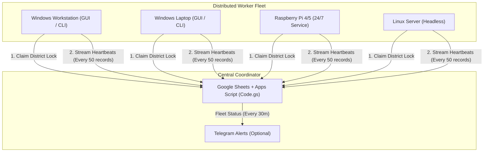

# FlawlessTech Data - Udayam Distributed Fleet Scraper

A high-performance, distributed web scraping and extraction engine for MSME Udayam registration data. It supports concurrent multi-machine operations across Windows PCs, laptops, and Linux / Raspberry Pi nodes coordinated centrally via Google Sheets and Telegram.

---

## 🏗️ System Architecture



- **Collision-Free Orchestration**: Each machine claims an atomic lock on an unassigned district via the Google Apps Script Web App.
- **Continuous Progress Sync**: Workers report heartbeats every 50 records with live speed (RPM), total extracted, and failure counts.
- **Auto-Archiving**: Completed districts are automatically compressed into `.7z` archives and uploaded directly to Google Drive.

---

## 📋 Multi-Device Setup Guide

### Step 1: Set Up the Central Coordinator (One-Time Setup)

1. Open your master tracking Google Sheet.
2. In the top menu, go to **Extensions** $\to$ **Apps Script**.
3. Replace any existing script with the full contents of `orchestrator/Code.gs`.
4. *(Optional)* Add your Telegram credentials at the top of `Code.gs` (`TELEGRAM_BOT_TOKEN` & `TELEGRAM_CHAT_ID`).
5. In the top right, click **Deploy** $\to$ **New deployment**:
   - **Type**: Web app (click the gear icon)
   - **Description**: `Udayam Fleet Coordinator`
   - **Execute as**: `Me (your email)`
   - **Who has access**: `Anyone` *(Crucial: allows worker devices to communicate without requiring Google API client credentials)*
6. Click **Deploy**, grant permissions if prompted, and copy the **Web App URL** (e.g. `https://script.google.com/macros/s/.../exec`).

> [!TIP]
> **Automated Telegram Updates**: In Apps Script, open the **Triggers** tab (clock icon) $\to$ **+ Add Trigger** $\to$ select `sendTelegramFleetReport` with a `Time-driven` $\to$ `Every 30 minutes` schedule.

---

### Step 2: Generate the Fleet Distribution Package

On your development / master computer, run:

```powershell
uv run python build_dist_package.py
```

This generates a lightweight, self-contained zip file in `dist/` (approx. 1.9 MB):
`dist/UdayamExtractor_FleetPackage_YYYYMMDD_HHMM.zip` (excludes virtual environments, bulky logs, and cache folders).

---

### Step 3: Deploy to Target Devices

#### Option A: Windows Devices (Desktops / Laptops)

1. **Extract Package**:
   Copy the `.zip` package to the target machine (via USB or network share) and extract it to a permanent folder (e.g. `C:\UdayamExtractor` or `Desktop\UdayamExtractor`).

2. **Configure Central URL**:
   In the extracted folder, create or edit `.env`:
   ```env
   GOOGLE_APPS_SCRIPT_URL=https://script.google.com/macros/s/.../exec
   ```

3. **Run 1-Click Automated Setup**:
   Double-click `setup_machine.bat`. The script will automatically:
   - Install the standalone `uv` package manager (fast, no administrator rights needed).
   - Create an isolated Python virtual environment and install all dependencies (`playwright`, `scrapling`, `ddddocr`, `openpyxl`, `httpx`).
   - Download the headless Chromium browser binaries.
   - Place a **Udayam Extractor** shortcut on the Desktop.

4. **Launch the Worker**:
   - **Desktop GUI Mode**: Double-click the Desktop shortcut or run `run_worker.bat`. Enter a machine name (e.g. `Dell-01`, `HP-Laptop`) and click **▶ Start Auto-Extract**.
   - **Headless CLI Mode**:
     ```powershell
     uv run python client/app.py --cli --machine "PC-01" --concurrency 2
     ```

---

#### Option B: Raspberry Pi & Linux Devices (24/7 Always-On Worker Nodes)

> [!IMPORTANT]
> A **64-bit operating system** (`aarch64` or `arm64` on Raspberry Pi 4/5) is required because Playwright and ONNX (`ddddocr`) do not support 32-bit ARM. Check via `uname -m`.

1. **Copy & Unzip**:
   ```bash
   scp dist/UdayamExtractor_FleetPackage_*.zip pi@<pi-ip>:~/
   ssh pi@<pi-ip>
   unzip UdayamExtractor_FleetPackage_*.zip -d ~/udayam
   cd ~/udayam
   ```

2. **Configure URL**:
   ```bash
   echo "GOOGLE_APPS_SCRIPT_URL=https://script.google.com/macros/s/.../exec" > .env
   ```

3. **Run 1-Click Pi Setup**:
   ```bash
   chmod +x setup_raspberry_pi.sh run_pi_worker.sh
   ./setup_raspberry_pi.sh
   ```

4. **Run Extractions**:
   - **Interactive Launcher**:
     ```bash
     ./run_pi_worker.sh
     ```
     Select `[2] Fleet Worker` to connect to the Google Sheet.
   - **Run as a 24/7 Background Service (Systemd)**:
     To keep the worker running permanently and resume automatically after system reboots:
     ```bash
     sudo cp udyam-worker.service /etc/systemd/system/
     sudo systemctl daemon-reload
     sudo systemctl enable --now udyam-worker
     ```
     Check live status and logs:
     ```bash
     sudo systemctl status udyam-worker
     journalctl -u udyam-worker -f
     ```

---

## ⚙️ Worker Configuration & CLI Flags

When running `client/app.py` directly, you can customize execution parameters:

| Argument | Description | Default | Example |
| :--- | :--- | :--- | :--- |
| `--cli` | Runs in headless CLI mode instead of GUI | `False` | `--cli` |
| `--machine` | Unique identifier for the device in Google Sheets | Hostname | `--machine "Pi-01"` |
| `--concurrency` | Number of simultaneous browser scraping instances | `2` | `--concurrency 3` |
| `--state` | Restrict task claims to a specific state prefix | None (All) | `--state TN` |
| `--district` | Force worker to scrape a specific district code | None | `--district TN-02` |
| `--web-app-url` | Apps Script URL (overrides `.env`) | From `.env` | `--web-app-url "https://..."` |

### Recommended Concurrency Guidelines
- **Raspberry Pi 4 / 5 (4GB - 8GB RAM)**: `--concurrency 2`
- **Standard Laptop / Office PC (8GB - 16GB RAM)**: `--concurrency 2` to `3`
- **High-Performance Workstation (16GB+ RAM, Multi-core CPU)**: `--concurrency 4` to `6`

---

## 🔄 Syncing Past Local Data to Google Sheet

If districts were scraped prior to setting up the central coordinator, push existing `.7z` archives from your local `results/` folder into Google Sheets:

```powershell
uv run sync_existing_archives.py --web-app-url "<YOUR_WEB_APP_URL>"
```

This scans all completed archives and populates `Last Record`, `Total Records Extracted`, and `Status = Completed` to prevent duplicate extraction.

---

## 📌 Manual / Standalone Scraper Commands

For standalone extraction without the fleet coordinator:

```powershell
# Extract a specific district batch
uv run python extract_list.py --district TN-02 --incremental --count 50 --concurrency 2 --output results.xlsx --html

# Re-check failed records
uv run python extract_list.py --recheck-failed --output results.xlsx --html

# Legacy direct scraper
uv run scraper.py --state TN --code 1 --limit 500000
```
